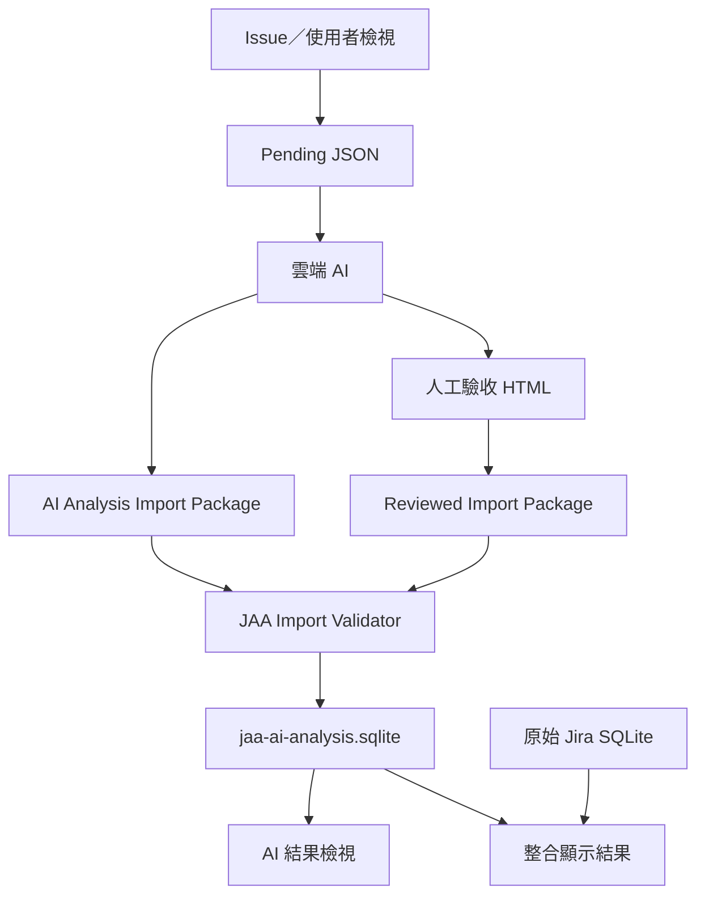

# JAA AI 分析資料庫設計 v1.0.0

- File: `JAA_AI_Analysis_Database_Design_v1.0.0.md`
- Document Version: `1.0.0`
- Status: `proposed-for-v0.3.38`
- Target Application: `JiraActivityAnalyzer`
- Target Application Version: `v0.3.38`
- Database Schema Name: `jaa-ai-analysis-sqlite`
- Database Schema Version: `1`
- Import Package Contract: `jaa-ai-analysis-import-package v1.0.0`
- Locale: `zh-TW`
- Time Zone for Storage: `UTC`
- Prepared Date: `2026-09-01`

## 1. 文件目的

本文件定義 JiraActivityAnalyzer（以下簡稱 JAA）v0.3.38 的獨立 AI 分析資料庫、統一匯入格式、去重與人工驗收保護、原始資料來源對應、Debug Receipt、UI 查詢邊界、Migration 與驗收標準。

本文件主要提供給：

- JAA v0.3.38 的 Codex 實作者。
- 實作前進行設計核准的人員。
- 未來維護 AI SQLite Schema、Importer 與整合檢視的工程師。
- Debug AI 分析資料無法對應原始資料的人員。

本文件不是每次交給雲端 AI 進行技能分類的輸入文件，也不是一般使用者每次匯入資料時需要選取的檔案。

## 2. 已凍結的產品決策

下列決策視為 v0.3.38 已核准範圍：

1. 原本 JAA 的 AI 分析頁封存，左側顯示 `AI 分析（封存中）`，點擊不執行 Route 或分析功能。
2. 原 AI 分析元件、IPC、Provider、Codex Runtime 與歷史檔案不刪除、不重構。
3. Pending JSON 繼續由 Issue 檢視或使用者檢視匯出。
4. 雲端 AI 分析流程維持手動：Pending JSON＋三份分析依據 MD＋HTML Template MD。
5. 雲端 AI 與人工驗收 HTML 最終都輸出同一契約的 `jaa-ai-analysis-import-package v1.0.0`。
6. JAA 不實作舊版 Analyzed Result／Manual Review 的多檔轉換工具；舊資料由雲端 AI 轉換成統一 Package。
7. JAA v0.3.38 正式 Importer 只接受新統一 Package。
8. AI 分析資料使用獨立 SQLite，不寫入原始 Jira SQLite。
9. 一個 JAA Data Root 使用一個全域 `jaa-ai-analysis.sqlite`，以 `jiraServerFingerprint` 與 `sourceDatabaseId` 區分來源。
10. 去重不可使用 `recordIndex`。
11. 人工驗收保護優先權固定為 `REVIEW_COMPLETED > REVIEW_PARTIAL > AI_ONLY`。
12. 低 Review Rank 的新資料不得覆蓋高 Review Rank 的既有資料。
13. 相同 Review Rank 採最新成功匯入資料，但完全相同內容應視為 Idempotent No-op。
14. 不允許把新版 AI 分析與舊版人工 Review 暗中合併。
15. 每筆目前有效的 AI Record 都必須有一筆目前來源對應狀態。
16. 每一次來源比對都必須留下 append-only Link Attempt，供後續 Debug。
17. 整合顯示結果以原始資料庫為基底，使用 LEFT JOIN 語意，不可隱藏未分析原始資料。
18. `UNANALYZED` 與 `SOURCE_RECORD_NOT_FOUND` 必須分開。
19. 匯入必須先 Preflight／Preview，再使用 Transaction 寫入。
20. Blocking validation 或 SQL 錯誤不得留下半套 AI Record。

## 3. 範圍與非目標

### 3.1 v0.3.38 範圍

- 封存原 AI 分析入口。
- 建立、Migration、開啟及驗證獨立 AI SQLite。
- 驗證與匯入統一 AI Analysis Import Package。
- 匯入 Preview、去重、Review Rank 保護、Import Receipt。
- AI 分析資料庫總覽。
- AI 結果檢視。
- 原始 SQLite＋AI SQLite 整合顯示。
- 已分析／未分析／Review／Skill／Link 狀態篩選。
- JSON／CSV 匯出。
- Source Link 與 Link Attempt Debug。
- Debug Bundle、時間帳、封裝、Commit、Tag、Push。

### 3.2 非目標

- 不由 JAA 呼叫 ChatGPT、Codex、OpenAI API 或 AI Nexus。
- 不在 JAA 內重新分類或補 Skill。
- 不在 JAA 內提供人工技能驗收編輯器。
- 不讓 AI SQLite 回寫、修正或刪除原始 Jira SQLite。
- 不支援舊格式的猜測式匯入。
- 不在第一版提供 AI 模型間比較、Rule Set 間差異分析或自動規則訓練。
- 不在第一版提供單筆 AI Record 的手動刪除或手動修改。

## 4. 高階架構



### 4.1 權威資料分層

| 層級 | 權威內容 | 可否被下一層覆寫 |
|---|---|---|
| 原始 Jira SQLite | Jira Issue、Comment、Changelog、Activity Event | 不可 |
| Source Snapshot | Pending 匯出當下的來源快照 | 不可推測修改 |
| AI Analysis | 雲端 AI 原始 Status、Finding、Evidence、Rationale | 人工 Review 不得直接改寫 |
| Manual Review | 人工 expectedStatus、Skill verdict、漏判 Skill | 只形成獨立 Review layer |
| Effective Result | 依 Review 狀態衍生的檢視結果 | 不作為原始資料回寫來源 |

## 5. 實體檔案與 Lifecycle

### 5.1 建議路徑

```text
{JAA_DATA_ROOT}/databases/ai-analysis/jaa-ai-analysis.sqlite
```

約束：

- 不得寫入 `%LOCALAPPDATA%`。
- Installer 與 Portable 都必須遵循現有 JAA Data Root／Portable containment。
- UI 必須顯示完整實體路徑。
- 原始 Jira SQLite 與 AI SQLite 必須是不同檔案。

### 5.2 SQLite Runtime PRAGMA

每次開啟 AI SQLite 時執行：

```sql
PRAGMA foreign_keys = ON;
PRAGMA journal_mode = WAL;
PRAGMA synchronous = FULL;
PRAGMA busy_timeout = 5000;
PRAGMA temp_store = MEMORY;
```

封裝、複製、Debug Bundle 或備份前：

```sql
PRAGMA wal_checkpoint(TRUNCATE);
```

不得只複製仍有未 checkpoint WAL 的主資料庫檔案。

### 5.3 Database Lifecycle

```text
NOT_FOUND
→ CREATE_SCHEMA_V1
→ READY
→ IMPORTING
→ READY

READY
→ MIGRATING
→ READY

任一 Integrity／Migration blocking failure
→ READ_ONLY_DIAGNOSTIC
```

## 6. 統一 Import Package 契約

### 6.1 契約身分

JAA v0.3.38 只接受：

```json
{
  "schemaName": "jaa-ai-analysis-import-package",
  "schemaVersion": "1.0.0",
  "schemaSha256": "<lowercase hex>",
  "minimumImporterVersion": "0.3.38",
  "requiredCapabilities": [
    "AI_ANALYSIS_SQLITE_V1",
    "SOURCE_RECORD_LINK_V1",
    "MANUAL_REVIEW_LAYER_V1"
  ]
}
```

JAA 必須同時驗證 Schema Name、Version、SHA、Minimum Importer Version 與 Required Capabilities。未知版本不得 silently fallback。

### 6.2 頂層資料結構

```json
{
  "schemaName": "jaa-ai-analysis-import-package",
  "schemaVersion": "1.0.0",
  "schemaSha256": "...",
  "minimumImporterVersion": "0.3.38",
  "requiredCapabilities": [],
  "packageId": "UUID",
  "createdAt": "ISO-8601",
  "generator": {},
  "sourceBinding": {},
  "rulesBinding": {},
  "templateBinding": null,
  "reviewCoverage": {},
  "records": [],
  "counts": {},
  "integrity": {},
  "conversionReceipt": null
}
```

### 6.3 Source Binding 必填欄位

```json
{
  "sourceBinding": {
    "pendingFilename": "pending-analysis_*.json",
    "pendingSha256": "...",
    "pendingSchemaName": "jira-activity-analyzer.pending-analysis",
    "pendingSchemaVersion": "...",
    "sourceDatabaseId": "...",
    "jiraServerFingerprint": "...",
    "jiraServerHost": "...",
    "exportId": "...",
    "sourceView": "USER_ALL_ACTIVITY_EVENTS",
    "createdAt": "...",
    "timezone": "Asia/Taipei",
    "sourceRecordCount": 59,
    "querySnapshot": {},
    "exportMetadata": {}
  }
}
```

### 6.4 Rules Binding 必填欄位

```json
{
  "rulesBinding": {
    "ruleSetId": "...",
    "manifestVersion": "...",
    "manifestSha256": "...",
    "commonRulesVersion": "...",
    "commonRulesSha256": "...",
    "catalogVersion": "...",
    "catalogSha256": "..."
  }
}
```

### 6.5 Template Binding

- 雲端 AI 直接產生且尚未進入 HTML 驗收時可為 `null`。
- 由 HTML 匯出的 Package 必須包含 Template ID、Version、Schema Version 與 SHA-256。

### 6.6 Record 必填結構

```json
{
  "recordIndex": 0,
  "dedupeKey": "...",
  "sourceReference": {
    "sourceDatabaseId": "...",
    "jiraServerFingerprint": "...",
    "evidenceId": "...",
    "activityEventId": "...",
    "sourceRecordStableId": "...",
    "issueId": "...",
    "issueKey": "...",
    "projectKey": "...",
    "fieldId": null,
    "fieldName": "Comment",
    "eventTime": "...",
    "actor": {
      "stableIdentity": "...",
      "displayValue": "..."
    },
    "sourceContentHash": "..."
  },
  "sourceSnapshot": {
    "issueType": null,
    "priority": null,
    "issueStatus": null,
    "beforeAvailability": "...",
    "afterAvailability": "...",
    "diffHunks": [],
    "readableContent": "..."
  },
  "aiAnalysis": {
    "status": "CLASSIFIED",
    "confidence": 0.9,
    "skillFindings": [],
    "recordNegativeChecks": [],
    "unknownReasons": [],
    "rationale": "..."
  },
  "manualReview": null,
  "integrity": {}
}
```

### 6.7 Review Coverage

```text
NONE       = 所有 records[].manualReview 都是 null
PARTIAL    = 至少一筆有 Review，但並非全部 Record completed
COMPLETED  = 所有 Record 都有 Review 且 completed=true
```

Package 層與 Record 層必須一致，不得只依檔名判定。

### 6.8 Canonical JSON 與 SHA-256

- 所有結構化內容 Hash 使用 UTF-8 與 JSON Canonicalization Scheme（RFC 8785）。
- Hash 使用 SHA-256 lowercase hex。
- `packageSha256` 計算時省略 `integrity.packageSha256` 欄位本身。
- `sourceReferencesSha256` 計算所有 Record 的 `sourceReference`＋`sourceSnapshot`。
- `aiAnalysisSha256` 計算所有 Record 的 `aiAnalysis`。
- `manualReviewSha256` 在 Review Coverage=`NONE` 時為 `null`，否則計算所有 Record 的 `manualReview`。
- HTML 匯出前後，`sourceReferencesSha256` 與 `aiAnalysisSha256` 必須完全相同。

### 6.9 dedupeKey 公式

```text
SHA-256 UTF-8 lowercase hex of:

JAA-AI-RECORD-v1\n
{sourceDatabaseId}\n
{evidenceId}
```

不得使用 `recordIndex`、Issue Key、Event Time 或 Source Record Stable ID 單獨去重。

## 7. Database Schema v1 DDL

以下 DDL 為 v0.3.38 Schema v1 的正式設計基準。實作可以拆成 Migration 檔，但語意、Constraint、Index 與 View 必須等價。

```sql
PRAGMA foreign_keys = ON;

CREATE TABLE ai_database_metadata (
    singleton_id INTEGER PRIMARY KEY CHECK (singleton_id = 1),
    database_id TEXT NOT NULL UNIQUE,
    schema_name TEXT NOT NULL CHECK (schema_name = 'jaa-ai-analysis-sqlite'),
    schema_version INTEGER NOT NULL CHECK (schema_version >= 1),
    created_at_utc TEXT NOT NULL,
    updated_at_utc TEXT NOT NULL,
    created_by_app_version TEXT NOT NULL,
    last_migrated_by_app_version TEXT NOT NULL,
    metadata_json TEXT NOT NULL DEFAULT '{}'
        CHECK (json_valid(metadata_json))
);

CREATE TABLE ai_import_batches (
    import_batch_id TEXT PRIMARY KEY,
    package_id TEXT NOT NULL,
    package_sha256 TEXT NOT NULL CHECK (length(package_sha256) = 64),
    original_file_name TEXT NOT NULL,
    original_file_path TEXT,
    original_file_size_bytes INTEGER NOT NULL CHECK (original_file_size_bytes >= 0),
    schema_name TEXT NOT NULL CHECK (schema_name = 'jaa-ai-analysis-import-package'),
    schema_version TEXT NOT NULL,
    schema_sha256 TEXT NOT NULL CHECK (length(schema_sha256) = 64),
    minimum_importer_version TEXT NOT NULL,
    required_capabilities_json TEXT NOT NULL
        CHECK (json_valid(required_capabilities_json)),
    generator_json TEXT NOT NULL CHECK (json_valid(generator_json)),
    source_database_id TEXT NOT NULL,
    jira_server_fingerprint TEXT NOT NULL,
    jira_server_host TEXT,
    pending_file_name TEXT NOT NULL,
    pending_sha256 TEXT NOT NULL CHECK (length(pending_sha256) = 64),
    pending_schema_name TEXT NOT NULL,
    pending_schema_version TEXT NOT NULL,
    export_id TEXT NOT NULL,
    source_view TEXT NOT NULL,
    source_created_at TEXT NOT NULL,
    source_timezone TEXT NOT NULL,
    query_snapshot_json TEXT NOT NULL CHECK (json_valid(query_snapshot_json)),
    export_metadata_json TEXT NOT NULL CHECK (json_valid(export_metadata_json)),
    rule_set_id TEXT NOT NULL,
    manifest_version TEXT NOT NULL,
    manifest_sha256 TEXT NOT NULL CHECK (length(manifest_sha256) = 64),
    common_rules_version TEXT NOT NULL,
    common_rules_sha256 TEXT NOT NULL CHECK (length(common_rules_sha256) = 64),
    catalog_version TEXT NOT NULL,
    catalog_sha256 TEXT NOT NULL CHECK (length(catalog_sha256) = 64),
    template_id TEXT,
    template_version TEXT,
    template_schema_version TEXT,
    template_sha256 TEXT CHECK (template_sha256 IS NULL OR length(template_sha256) = 64),
    review_coverage_state TEXT NOT NULL
        CHECK (review_coverage_state IN ('NONE', 'PARTIAL', 'COMPLETED')),
    declared_record_count INTEGER NOT NULL CHECK (declared_record_count >= 0),
    validated_record_count INTEGER NOT NULL CHECK (validated_record_count >= 0),
    inserted_count INTEGER NOT NULL DEFAULT 0 CHECK (inserted_count >= 0),
    replaced_count INTEGER NOT NULL DEFAULT 0 CHECK (replaced_count >= 0),
    protected_skip_count INTEGER NOT NULL DEFAULT 0 CHECK (protected_skip_count >= 0),
    identical_noop_count INTEGER NOT NULL DEFAULT 0 CHECK (identical_noop_count >= 0),
    matched_count INTEGER NOT NULL DEFAULT 0 CHECK (matched_count >= 0),
    unmatched_count INTEGER NOT NULL DEFAULT 0 CHECK (unmatched_count >= 0),
    ambiguous_count INTEGER NOT NULL DEFAULT 0 CHECK (ambiguous_count >= 0),
    status TEXT NOT NULL
        CHECK (status IN ('PREVIEWED', 'IMPORTING', 'COMPLETED', 'FAILED', 'ROLLED_BACK')),
    validation_summary_json TEXT NOT NULL DEFAULT '{}'
        CHECK (json_valid(validation_summary_json)),
    package_integrity_json TEXT NOT NULL CHECK (json_valid(package_integrity_json)),
    conversion_receipt_json TEXT
        CHECK (conversion_receipt_json IS NULL OR json_valid(conversion_receipt_json)),
    failure_code TEXT,
    failure_message TEXT,
    previewed_at_utc TEXT NOT NULL,
    imported_at_utc TEXT,
    completed_at_utc TEXT,
    importer_app_version TEXT NOT NULL
);

CREATE UNIQUE INDEX ux_ai_import_batches_completed_package_sha
    ON ai_import_batches(package_sha256)
    WHERE status = 'COMPLETED';

CREATE INDEX ix_ai_import_batches_source
    ON ai_import_batches(jira_server_fingerprint, source_database_id, completed_at_utc DESC);

CREATE INDEX ix_ai_import_batches_review
    ON ai_import_batches(review_coverage_state, completed_at_utc DESC);

CREATE TABLE ai_analysis_records (
    ai_record_id TEXT PRIMARY KEY,
    dedupe_key TEXT NOT NULL UNIQUE CHECK (length(dedupe_key) = 64),
    source_database_id TEXT NOT NULL,
    jira_server_fingerprint TEXT NOT NULL,
    evidence_id TEXT NOT NULL,
    activity_event_id TEXT NOT NULL,
    source_record_stable_id TEXT NOT NULL,
    issue_id TEXT,
    issue_key TEXT NOT NULL,
    project_key TEXT,
    issue_type TEXT,
    priority TEXT,
    issue_status TEXT,
    field_id TEXT,
    field_name TEXT NOT NULL,
    event_time_utc TEXT NOT NULL,
    actor_stable_identity TEXT NOT NULL,
    actor_display_value TEXT NOT NULL,
    source_content_hash TEXT NOT NULL CHECK (length(source_content_hash) = 64),
    source_reference_json TEXT NOT NULL CHECK (json_valid(source_reference_json)),
    source_snapshot_json TEXT NOT NULL CHECK (json_valid(source_snapshot_json)),
    ai_status TEXT NOT NULL
        CHECK (ai_status IN ('CLASSIFIED', 'UNKNOWN', 'EXCLUDED', 'FAILED')),
    ai_confidence REAL NOT NULL
        CHECK (ai_confidence IN (0.0, 0.3, 0.6, 0.9)),
    ai_rationale TEXT NOT NULL,
    ai_record_negative_checks_json TEXT NOT NULL DEFAULT '[]'
        CHECK (json_valid(ai_record_negative_checks_json)),
    ai_unknown_reasons_json TEXT NOT NULL DEFAULT '[]'
        CHECK (json_valid(ai_unknown_reasons_json)),
    ai_analysis_json TEXT NOT NULL CHECK (json_valid(ai_analysis_json)),
    review_state TEXT NOT NULL
        CHECK (review_state IN ('AI_ONLY', 'REVIEW_PARTIAL', 'REVIEW_COMPLETED')),
    effective_status TEXT NOT NULL
        CHECK (effective_status IN ('CLASSIFIED', 'UNKNOWN', 'EXCLUDED', 'FAILED')),
    effective_status_source TEXT NOT NULL
        CHECK (effective_status_source IN ('AI', 'MANUAL_COMPLETED')),
    is_human_verified INTEGER NOT NULL DEFAULT 0
        CHECK (is_human_verified IN (0, 1)),
    manual_review_json TEXT
        CHECK (manual_review_json IS NULL OR json_valid(manual_review_json)),
    ai_analysis_sha256 TEXT NOT NULL CHECK (length(ai_analysis_sha256) = 64),
    manual_review_sha256 TEXT
        CHECK (manual_review_sha256 IS NULL OR length(manual_review_sha256) = 64),
    record_integrity_sha256 TEXT NOT NULL CHECK (length(record_integrity_sha256) = 64),
    current_import_batch_id TEXT NOT NULL,
    first_imported_at_utc TEXT NOT NULL,
    updated_at_utc TEXT NOT NULL,
    row_version INTEGER NOT NULL DEFAULT 1 CHECK (row_version >= 1),
    FOREIGN KEY (current_import_batch_id)
        REFERENCES ai_import_batches(import_batch_id)
        ON UPDATE RESTRICT ON DELETE RESTRICT,
    UNIQUE (source_database_id, evidence_id)
);

CREATE INDEX ix_ai_records_source_activity
    ON ai_analysis_records(source_database_id, activity_event_id);

CREATE INDEX ix_ai_records_source_stable
    ON ai_analysis_records(source_database_id, source_record_stable_id, field_name, event_time_utc);

CREATE INDEX ix_ai_records_actor_time
    ON ai_analysis_records(actor_stable_identity, event_time_utc DESC);

CREATE INDEX ix_ai_records_issue_time
    ON ai_analysis_records(issue_key, event_time_utc DESC);

CREATE INDEX ix_ai_records_project_time
    ON ai_analysis_records(project_key, event_time_utc DESC);

CREATE INDEX ix_ai_records_status
    ON ai_analysis_records(ai_status, review_state, event_time_utc DESC);

CREATE INDEX ix_ai_records_effective_status
    ON ai_analysis_records(effective_status, is_human_verified, event_time_utc DESC);

CREATE INDEX ix_ai_records_source_hash
    ON ai_analysis_records(source_database_id, source_content_hash);

CREATE TABLE ai_skill_findings (
    ai_finding_id TEXT PRIMARY KEY,
    ai_record_id TEXT NOT NULL,
    finding_ordinal INTEGER NOT NULL CHECK (finding_ordinal >= 0),
    skill_id TEXT NOT NULL,
    skill_name TEXT NOT NULL,
    skill_group TEXT NOT NULL,
    ai_confidence REAL NOT NULL CHECK (ai_confidence IN (0.3, 0.6, 0.9)),
    evidence_explanation TEXT NOT NULL,
    rationale TEXT NOT NULL,
    negative_checks_json TEXT NOT NULL DEFAULT '[]'
        CHECK (json_valid(negative_checks_json)),
    near_skills_json TEXT NOT NULL DEFAULT '[]'
        CHECK (json_valid(near_skills_json)),
    finding_json TEXT NOT NULL CHECK (json_valid(finding_json)),
    finding_sha256 TEXT NOT NULL CHECK (length(finding_sha256) = 64),
    FOREIGN KEY (ai_record_id)
        REFERENCES ai_analysis_records(ai_record_id)
        ON UPDATE RESTRICT ON DELETE CASCADE,
    UNIQUE (ai_record_id, finding_ordinal),
    UNIQUE (ai_record_id, skill_id),
    UNIQUE (ai_finding_id, ai_record_id)
);

CREATE INDEX ix_ai_findings_skill
    ON ai_skill_findings(skill_id, ai_confidence);

CREATE INDEX ix_ai_findings_group
    ON ai_skill_findings(skill_group, skill_id);

CREATE TABLE ai_skill_evidence (
    ai_evidence_row_id TEXT PRIMARY KEY,
    ai_finding_id TEXT NOT NULL,
    evidence_ordinal INTEGER NOT NULL CHECK (evidence_ordinal >= 0),
    source_json_pointer TEXT NOT NULL,
    quote TEXT NOT NULL,
    quote_sha256 TEXT NOT NULL CHECK (length(quote_sha256) = 64),
    evidence_role TEXT,
    explanation TEXT,
    FOREIGN KEY (ai_finding_id)
        REFERENCES ai_skill_findings(ai_finding_id)
        ON UPDATE RESTRICT ON DELETE CASCADE,
    UNIQUE (ai_finding_id, evidence_ordinal)
);

CREATE INDEX ix_ai_evidence_quote_sha
    ON ai_skill_evidence(quote_sha256);

CREATE TABLE ai_record_reviews (
    ai_record_id TEXT PRIMARY KEY,
    expected_status TEXT NOT NULL
        CHECK (expected_status IN ('CLASSIFIED', 'UNKNOWN', 'EXCLUDED', 'FAILED', 'UNDECIDED')),
    status_agreement TEXT NOT NULL
        CHECK (status_agreement IN ('AGREE', 'DISAGREE', 'UNREVIEWED')),
    skill_identification_state TEXT NOT NULL
        CHECK (skill_identification_state IN ('IDENTIFIED', 'NOT_APPLICABLE', 'NEEDS_DOMAIN_FOLLOWUP')),
    notes TEXT NOT NULL DEFAULT '',
    completed INTEGER NOT NULL CHECK (completed IN (0, 1)),
    reviewer TEXT NOT NULL DEFAULT '',
    review_schema_name TEXT NOT NULL,
    review_schema_version TEXT NOT NULL,
    review_schema_sha256 TEXT NOT NULL CHECK (length(review_schema_sha256) = 64),
    review_origin TEXT NOT NULL,
    review_created_at_local TEXT,
    review_updated_at_local TEXT,
    imported_at_utc TEXT NOT NULL,
    review_json TEXT NOT NULL CHECK (json_valid(review_json)),
    FOREIGN KEY (ai_record_id)
        REFERENCES ai_analysis_records(ai_record_id)
        ON UPDATE RESTRICT ON DELETE CASCADE,
    CHECK (completed = 0 OR expected_status <> 'UNDECIDED')
);

CREATE INDEX ix_ai_record_reviews_status
    ON ai_record_reviews(completed, expected_status, status_agreement);

CREATE TABLE ai_skill_reviews (
    skill_review_id TEXT PRIMARY KEY,
    ai_record_id TEXT NOT NULL,
    ai_finding_id TEXT NOT NULL,
    skill_id TEXT NOT NULL,
    ai_confidence REAL NOT NULL CHECK (ai_confidence IN (0.3, 0.6, 0.9)),
    verdict TEXT NOT NULL
        CHECK (verdict IN (
            'UNREVIEWED',
            'ACCEPT',
            'REJECT_WRONG_SKILL',
            'REJECT_EVIDENCE_INSUFFICIENT',
            'ADJUST_CONFIDENCE',
            'UNCERTAIN'
        )),
    proposed_confidence REAL
        CHECK (proposed_confidence IS NULL OR proposed_confidence IN (0.3, 0.6, 0.9)),
    notes TEXT NOT NULL DEFAULT '',
    review_json TEXT NOT NULL CHECK (json_valid(review_json)),
    FOREIGN KEY (ai_record_id)
        REFERENCES ai_analysis_records(ai_record_id)
        ON UPDATE RESTRICT ON DELETE CASCADE,
    FOREIGN KEY (ai_finding_id, ai_record_id)
        REFERENCES ai_skill_findings(ai_finding_id, ai_record_id)
        ON UPDATE RESTRICT ON DELETE CASCADE,
    UNIQUE (ai_record_id, skill_id),
    CHECK (
        (verdict = 'ADJUST_CONFIDENCE' AND proposed_confidence IS NOT NULL)
        OR
        (verdict <> 'ADJUST_CONFIDENCE' AND proposed_confidence IS NULL)
    )
);

CREATE INDEX ix_ai_skill_reviews_verdict
    ON ai_skill_reviews(verdict, skill_id);

CREATE TABLE ai_missing_skill_reviews (
    missing_review_id TEXT PRIMARY KEY,
    ai_record_id TEXT NOT NULL,
    skill_id TEXT NOT NULL,
    skill_name TEXT NOT NULL,
    skill_group TEXT NOT NULL,
    suggested_confidence REAL NOT NULL CHECK (suggested_confidence IN (0.3, 0.6, 0.9)),
    source_json_pointer TEXT NOT NULL,
    quote TEXT NOT NULL,
    quote_sha256 TEXT NOT NULL CHECK (length(quote_sha256) = 64),
    reason TEXT NOT NULL,
    negative_checks_json TEXT NOT NULL DEFAULT '[]'
        CHECK (json_valid(negative_checks_json)),
    review_origin TEXT NOT NULL,
    confirmed INTEGER NOT NULL CHECK (confirmed IN (0, 1)),
    review_json TEXT NOT NULL CHECK (json_valid(review_json)),
    FOREIGN KEY (ai_record_id)
        REFERENCES ai_analysis_records(ai_record_id)
        ON UPDATE RESTRICT ON DELETE CASCADE,
    UNIQUE (ai_record_id, skill_id)
);

CREATE INDEX ix_ai_missing_skills_skill
    ON ai_missing_skill_reviews(skill_id, confirmed);

CREATE TABLE ai_additional_evidence_assignments (
    assignment_id TEXT PRIMARY KEY,
    ai_record_id TEXT NOT NULL,
    target_skill_id TEXT NOT NULL,
    target_skill_presence TEXT NOT NULL
        CHECK (target_skill_presence IN ('EXISTING', 'MISSING')),
    source_finding_skill_id TEXT,
    source_json_pointer TEXT NOT NULL,
    quote TEXT NOT NULL,
    quote_sha256 TEXT NOT NULL CHECK (length(quote_sha256) = 64),
    suggested_confidence REAL
        CHECK (suggested_confidence IS NULL OR suggested_confidence IN (0.3, 0.6, 0.9)),
    reason TEXT NOT NULL,
    negative_checks_json TEXT NOT NULL DEFAULT '[]'
        CHECK (json_valid(negative_checks_json)),
    review_origin TEXT NOT NULL,
    confirmed INTEGER NOT NULL CHECK (confirmed IN (0, 1)),
    assignment_json TEXT NOT NULL CHECK (json_valid(assignment_json)),
    FOREIGN KEY (ai_record_id)
        REFERENCES ai_analysis_records(ai_record_id)
        ON UPDATE RESTRICT ON DELETE CASCADE,
    UNIQUE (ai_record_id, target_skill_id, source_json_pointer, quote_sha256)
);

CREATE INDEX ix_ai_additional_evidence_target
    ON ai_additional_evidence_assignments(target_skill_id, target_skill_presence, confirmed);

CREATE TABLE ai_source_links (
    ai_record_id TEXT PRIMARY KEY,
    link_status TEXT NOT NULL
        CHECK (link_status IN (
            'MATCHED',
            'SOURCE_DATABASE_NOT_AVAILABLE',
            'SOURCE_RECORD_NOT_FOUND',
            'AMBIGUOUS',
            'SOURCE_IDENTITY_MISMATCH',
            'SOURCE_CONTENT_MISMATCH',
            'LINK_ERROR',
            'NOT_ATTEMPTED'
        )),
    link_method TEXT
        CHECK (link_method IS NULL OR link_method IN (
            'SOURCE_DATABASE_AND_ACTIVITY_EVENT',
            'STABLE_RECORD_FALLBACK'
        )),
    matched_source_database_id TEXT,
    matched_activity_event_id TEXT,
    matched_raw_record_id TEXT,
    candidate_count INTEGER NOT NULL DEFAULT 0 CHECK (candidate_count >= 0),
    source_identity_match INTEGER
        CHECK (source_identity_match IS NULL OR source_identity_match IN (0, 1)),
    source_content_match INTEGER
        CHECK (source_content_match IS NULL OR source_content_match IN (0, 1)),
    diagnostic_code TEXT,
    diagnostic_message TEXT,
    first_attempt_at_utc TEXT,
    last_attempt_at_utc TEXT,
    attempt_count INTEGER NOT NULL DEFAULT 0 CHECK (attempt_count >= 0),
    link_debug_json TEXT NOT NULL DEFAULT '{}'
        CHECK (json_valid(link_debug_json)),
    FOREIGN KEY (ai_record_id)
        REFERENCES ai_analysis_records(ai_record_id)
        ON UPDATE RESTRICT ON DELETE CASCADE,
    CHECK (
        link_status <> 'MATCHED'
        OR (
            link_method IS NOT NULL
            AND matched_source_database_id IS NOT NULL
            AND matched_activity_event_id IS NOT NULL
        )
    )
);

CREATE INDEX ix_ai_source_links_status
    ON ai_source_links(link_status, link_method);

CREATE INDEX ix_ai_source_links_matched_activity
    ON ai_source_links(matched_source_database_id, matched_activity_event_id);

CREATE TABLE ai_source_link_attempts (
    link_attempt_id TEXT PRIMARY KEY,
    ai_record_id TEXT NOT NULL,
    import_batch_id TEXT,
    trigger_type TEXT NOT NULL
        CHECK (trigger_type IN (
            'IMPORT',
            'DATABASE_OPENED',
            'DATABASE_REPLACED',
            'MANUAL_RELINK',
            'APP_MIGRATION'
        )),
    target_source_database_id TEXT,
    target_jira_server_fingerprint TEXT,
    attempted_primary_key_json TEXT NOT NULL
        CHECK (json_valid(attempted_primary_key_json)),
    attempted_fallback_key_json TEXT NOT NULL
        CHECK (json_valid(attempted_fallback_key_json)),
    candidate_count INTEGER NOT NULL DEFAULT 0 CHECK (candidate_count >= 0),
    candidate_ids_json TEXT NOT NULL DEFAULT '[]'
        CHECK (json_valid(candidate_ids_json)),
    result_status TEXT NOT NULL
        CHECK (result_status IN (
            'MATCHED',
            'SOURCE_DATABASE_NOT_AVAILABLE',
            'SOURCE_RECORD_NOT_FOUND',
            'AMBIGUOUS',
            'SOURCE_IDENTITY_MISMATCH',
            'SOURCE_CONTENT_MISMATCH',
            'LINK_ERROR',
            'NOT_ATTEMPTED'
        )),
    result_method TEXT
        CHECK (result_method IS NULL OR result_method IN (
            'SOURCE_DATABASE_AND_ACTIVITY_EVENT',
            'STABLE_RECORD_FALLBACK'
        )),
    diagnostic_code TEXT,
    diagnostic_message TEXT,
    attempted_at_utc TEXT NOT NULL,
    app_version TEXT NOT NULL,
    duration_ms INTEGER CHECK (duration_ms IS NULL OR duration_ms >= 0),
    FOREIGN KEY (ai_record_id)
        REFERENCES ai_analysis_records(ai_record_id)
        ON UPDATE RESTRICT ON DELETE CASCADE,
    FOREIGN KEY (import_batch_id)
        REFERENCES ai_import_batches(import_batch_id)
        ON UPDATE RESTRICT ON DELETE SET NULL
);

CREATE INDEX ix_ai_link_attempts_record_time
    ON ai_source_link_attempts(ai_record_id, attempted_at_utc DESC);

CREATE INDEX ix_ai_link_attempts_result
    ON ai_source_link_attempts(result_status, attempted_at_utc DESC);

CREATE TABLE ai_import_actions (
    import_action_id TEXT PRIMARY KEY,
    import_batch_id TEXT NOT NULL,
    input_record_index INTEGER NOT NULL CHECK (input_record_index >= 0),
    evidence_id TEXT NOT NULL,
    dedupe_key TEXT NOT NULL CHECK (length(dedupe_key) = 64),
    existing_ai_record_id TEXT,
    resulting_ai_record_id TEXT,
    existing_review_state TEXT
        CHECK (existing_review_state IS NULL OR existing_review_state IN (
            'AI_ONLY', 'REVIEW_PARTIAL', 'REVIEW_COMPLETED'
        )),
    incoming_review_state TEXT NOT NULL
        CHECK (incoming_review_state IN ('AI_ONLY', 'REVIEW_PARTIAL', 'REVIEW_COMPLETED')),
    action_type TEXT NOT NULL
        CHECK (action_type IN (
            'INSERTED',
            'REPLACED',
            'SKIPPED_PROTECTED_REVIEW',
            'NOOP_IDENTICAL',
            'REJECTED_VALIDATION'
        )),
    reason_code TEXT NOT NULL,
    reason_message TEXT NOT NULL,
    existing_ai_analysis_sha256 TEXT
        CHECK (existing_ai_analysis_sha256 IS NULL OR length(existing_ai_analysis_sha256) = 64),
    incoming_ai_analysis_sha256 TEXT NOT NULL
        CHECK (length(incoming_ai_analysis_sha256) = 64),
    existing_manual_review_sha256 TEXT
        CHECK (existing_manual_review_sha256 IS NULL OR length(existing_manual_review_sha256) = 64),
    incoming_manual_review_sha256 TEXT
        CHECK (incoming_manual_review_sha256 IS NULL OR length(incoming_manual_review_sha256) = 64),
    link_status_after_action TEXT,
    occurred_at_utc TEXT NOT NULL,
    action_debug_json TEXT NOT NULL DEFAULT '{}'
        CHECK (json_valid(action_debug_json)),
    FOREIGN KEY (import_batch_id)
        REFERENCES ai_import_batches(import_batch_id)
        ON UPDATE RESTRICT ON DELETE CASCADE,
    FOREIGN KEY (existing_ai_record_id)
        REFERENCES ai_analysis_records(ai_record_id)
        ON UPDATE RESTRICT ON DELETE SET NULL,
    FOREIGN KEY (resulting_ai_record_id)
        REFERENCES ai_analysis_records(ai_record_id)
        ON UPDATE RESTRICT ON DELETE SET NULL,
    UNIQUE (import_batch_id, input_record_index)
);

CREATE INDEX ix_ai_import_actions_batch_type
    ON ai_import_actions(import_batch_id, action_type);

CREATE INDEX ix_ai_import_actions_dedupe
    ON ai_import_actions(dedupe_key, occurred_at_utc DESC);

CREATE VIEW v_ai_record_overview AS
SELECT
    r.ai_record_id,
    r.dedupe_key,
    r.source_database_id,
    r.jira_server_fingerprint,
    r.evidence_id,
    r.activity_event_id,
    r.issue_key,
    r.project_key,
    r.issue_type,
    r.priority,
    r.field_name,
    r.event_time_utc,
    r.actor_stable_identity,
    r.actor_display_value,
    r.ai_status,
    r.ai_confidence,
    r.review_state,
    r.effective_status,
    r.effective_status_source,
    r.is_human_verified,
    COALESCE(l.link_status, 'NOT_ATTEMPTED') AS link_status,
    l.link_method,
    l.matched_raw_record_id,
    l.diagnostic_code AS link_diagnostic_code,
    COUNT(DISTINCT f.ai_finding_id) AS ai_skill_finding_count,
    COUNT(DISTINCT m.missing_review_id) AS missing_skill_count,
    r.current_import_batch_id,
    r.updated_at_utc
FROM ai_analysis_records r
LEFT JOIN ai_source_links l ON l.ai_record_id = r.ai_record_id
LEFT JOIN ai_skill_findings f ON f.ai_record_id = r.ai_record_id
LEFT JOIN ai_missing_skill_reviews m ON m.ai_record_id = r.ai_record_id
GROUP BY r.ai_record_id;

CREATE VIEW v_ai_effective_skills AS
SELECT
    r.ai_record_id,
    f.skill_id,
    f.skill_name,
    f.skill_group,
    CASE
        WHEN r.review_state = 'REVIEW_COMPLETED'
             AND sr.verdict = 'ADJUST_CONFIDENCE'
        THEN sr.proposed_confidence
        ELSE f.ai_confidence
    END AS effective_confidence,
    CASE
        WHEN r.review_state = 'REVIEW_COMPLETED' THEN 'AI_REVIEW_ACCEPTED'
        ELSE 'AI_UNVERIFIED'
    END AS effective_skill_source,
    sr.verdict AS manual_verdict
FROM ai_analysis_records r
JOIN ai_skill_findings f ON f.ai_record_id = r.ai_record_id
LEFT JOIN ai_skill_reviews sr
    ON sr.ai_record_id = r.ai_record_id
   AND sr.ai_finding_id = f.ai_finding_id
WHERE
    r.review_state <> 'REVIEW_COMPLETED'
    OR sr.verdict IN ('ACCEPT', 'ADJUST_CONFIDENCE')

UNION ALL

SELECT
    r.ai_record_id,
    m.skill_id,
    m.skill_name,
    m.skill_group,
    m.suggested_confidence AS effective_confidence,
    'MANUAL_MISSING' AS effective_skill_source,
    'ACCEPT' AS manual_verdict
FROM ai_analysis_records r
JOIN ai_missing_skill_reviews m ON m.ai_record_id = r.ai_record_id
WHERE r.review_state = 'REVIEW_COMPLETED'
  AND m.confirmed = 1;

CREATE VIEW v_ai_import_batch_summary AS
SELECT
    b.import_batch_id,
    b.original_file_name,
    b.package_sha256,
    b.source_database_id,
    b.jira_server_fingerprint,
    b.pending_file_name,
    b.rule_set_id,
    b.review_coverage_state,
    b.declared_record_count,
    b.inserted_count,
    b.replaced_count,
    b.protected_skip_count,
    b.identical_noop_count,
    b.matched_count,
    b.unmatched_count,
    b.ambiguous_count,
    b.status,
    b.completed_at_utc,
    b.importer_app_version
FROM ai_import_batches b;

PRAGMA user_version = 1;
```

## 8. 資料表責任與不可變條件

### 8.1 `ai_analysis_records`

- 一列代表一個去重後目前有效的 AI Record。
- 同一 `dedupe_key` 永遠只有一列。
- Replace 應更新同一 `ai_record_id`，保留 Link Attempt 歷史，而不是刪除後建立無關的新 ID。
- `source_reference_json`、`source_snapshot_json`、`ai_analysis_json`、`manual_review_json` 用於 lossless 保存。
- 正規化欄位用於查詢、統計、Index 與 Constraint。

### 8.2 `ai_import_batches`

- 每次 Confirmed Import 建立一筆 Batch。
- 同一個已完成 `package_sha256` 再次匯入為 Idempotent，回傳既有 Receipt，不新增 Record。
- Preflight 尚未 Confirm 時可只存在記憶體；若寫入 `PREVIEWED`，取消後必須有明確狀態，不可被視為成功匯入。
- Transaction 失敗後，Record 寫入全部 rollback；可用獨立小 Transaction 保存 `FAILED`／`ROLLED_BACK` Batch Receipt。

### 8.3 `ai_import_actions`

- 每個輸入 Record 都必須有一筆 action。
- `SKIPPED_PROTECTED_REVIEW` 不得修改現有 Record、Child Rows 或目前 Source Link。
- `REPLACED` 必須記錄舊／新 Analysis SHA 與 Review SHA。
- `NOOP_IDENTICAL` 不增加 row_version。

### 8.4 Review Tables

- `AI_ONLY` 不得存在 `ai_record_reviews`。
- `REVIEW_PARTIAL`／`REVIEW_COMPLETED` 必須存在 `ai_record_reviews`。
- `REVIEW_COMPLETED` 必須 completed=1，且每個 AI Finding 都有非 `UNREVIEWED` 的 Skill Review。
- `REVIEW_PARTIAL` 不得被統計為人工定版結果。
- Missing Skill 不得與同一 Record 既有 AI Finding 使用相同 Skill ID。

### 8.5 Source Link Tables

- 每個 `ai_analysis_records` 必須有一筆 `ai_source_links`。
- `ai_source_links` 保存目前結果。
- `ai_source_link_attempts` append-only，不因目前結果更新而刪除。
- `matched_raw_record_id` 是原始 SQLite 的 opaque identifier，不建立跨 SQLite Foreign Key。

## 9. Review Rank 與覆蓋規則

### 9.1 Rank

```text
AI_ONLY          = 0
REVIEW_PARTIAL   = 1
REVIEW_COMPLETED = 2
```

### 9.2 決策公式

```text
incomingRank < existingRank
    → SKIPPED_PROTECTED_REVIEW

incomingRank = existingRank 且 Analysis／Review／Source Hash 全部相同
    → NOOP_IDENTICAL

incomingRank >= existingRank 且內容不同
    → REPLACED

沒有 existing record
    → INSERTED
```

### 9.3 覆蓋矩陣

| Existing | Incoming | 結果 |
|---|---|---|
| 無 | 任意 | INSERTED |
| AI_ONLY | AI_ONLY | 相同則 NOOP，否則 REPLACED |
| AI_ONLY | REVIEW_PARTIAL | REPLACED |
| AI_ONLY | REVIEW_COMPLETED | REPLACED |
| REVIEW_PARTIAL | AI_ONLY | SKIPPED_PROTECTED_REVIEW |
| REVIEW_PARTIAL | REVIEW_PARTIAL | 相同則 NOOP，否則 REPLACED |
| REVIEW_PARTIAL | REVIEW_COMPLETED | REPLACED |
| REVIEW_COMPLETED | AI_ONLY | SKIPPED_PROTECTED_REVIEW |
| REVIEW_COMPLETED | REVIEW_PARTIAL | SKIPPED_PROTECTED_REVIEW |
| REVIEW_COMPLETED | REVIEW_COMPLETED | 相同則 NOOP，否則 REPLACED |

### 9.4 Replace 實作要求

Replace 不做欄位 Merge：

1. 保留既有 `ai_record_id` 與 `first_imported_at_utc`。
2. 保存舊 Analysis／Review SHA 到 Import Action。
3. 刪除並重建該 Record 的 Finding、Evidence、Review、Missing Skill 與 Assignment children。
4. 更新 Record 的完整 Source／Analysis／Review layer。
5. `row_version += 1`。
6. 重跑 Source Link，更新目前 Link，追加 Link Attempt。
7. 不刪除過去 Link Attempts 與 Import Actions。

## 10. Import Preflight 與 Transaction

### 10.1 Preflight Gate

依序驗證：

1. 檔案可讀、大小合理、UTF-8 JSON 可解析。
2. Schema Name／Version／SHA 符合 JAA 內建契約。
3. Minimum Importer Version 與 Required Capabilities 符合。
4. Top-level required fields 完整。
5. Package SHA、Source SHA、AI Analysis SHA、Review SHA 可重算。
6. Source Binding、Rules Binding 與 Template Binding 合法。
7. `records.length` 與 declared counts 一致。
8. `recordIndex` 從 0 連續、唯一且順序守恆。
9. `dedupeKey`、`evidenceId` 在 Package 內唯一。
10. dedupeKey 可依公式重算。
11. 每筆 Source Reference 必填身分完整。
12. 每筆 AI Status、Confidence、Finding、Evidence 合法。
13. Skill ID 存在於綁定 Catalog，且同 Record 不重複。
14. Evidence pointer／quote 非空，Quote Hash 可重算。
15. Review Coverage 與 Record Review 狀態一致。
16. Completed Review 滿足人工完成閘門。
17. Preview 現有資料 Review Rank 與預計 Action。
18. Preview Source Link 可能結果，不將 Preview 當成正式 Link Attempt。

任一 Blocking Gate 失敗：

- 顯示 `REJECTED`。
- 不開始主 Transaction。
- 不修改 AI Record。
- 可匯出 Import Diagnostic JSON。

### 10.2 Import Preview

至少顯示：

```text
相容性
Schema／Package SHA
來源 Pending／Source Database
Review Coverage
Records
新增數
可覆蓋數
人工保護跳過數
完全相同 No-op 數
預計 Link 成功／失敗／多候選數
```

### 10.3 主 Transaction

```text
BEGIN IMMEDIATE
  INSERT ai_import_batches(status='IMPORTING')
  FOR EACH validated record in recordIndex order
    decide INSERTED／REPLACED／PROTECTED／NOOP
    persist current record and children when applicable
    persist ai_import_actions
    perform source matching when applicable
    update ai_source_links
    append ai_source_link_attempts
  validate transaction invariants
  update ai_import_batches counts and status='COMPLETED'
COMMIT
```

任何 SQL／Invariant Error：

```text
ROLLBACK
write external diagnostic
optionally write FAILED batch receipt in a separate transaction
```

不得對每筆 Record 各自 Commit。

## 11. Source Link 演算法

### 11.1 Match 前提

- 使用者目前開啟或可解析的原始 SQLite 必須回報 `sourceDatabaseId` 與 `jiraServerFingerprint`。
- AI Record 的 Source Binding 不可被目前 UI 選擇暗中替換。
- 原始 SQLite 全程唯讀。

### 11.2 Primary Match

```text
sourceDatabaseId + activityEventId
```

唯一命中且 Source Identity／Content 驗證通過：

```text
link_status = MATCHED
link_method = SOURCE_DATABASE_AND_ACTIVITY_EVENT
```

### 11.3 Fallback Match

Primary 找不到時才使用：

```text
sourceDatabaseId
+ sourceRecordStableId
+ fieldName
+ eventTime
```

唯一命中且內容驗證通過：

```text
link_status = MATCHED
link_method = STABLE_RECORD_FALLBACK
```

### 11.4 Candidate Verification

以下只用於驗證候選，不得單獨在多筆中猜選：

- `sourceContentHash`
- `evidenceId`
- `issueKey`
- `actorStableIdentity`
- Field／Event Time

### 11.5 Link Status

| Status | 定義 |
|---|---|
| MATCHED | 唯一對應且驗證通過 |
| SOURCE_DATABASE_NOT_AVAILABLE | 對應的原始 SQLite 未開啟或不存在 |
| SOURCE_RECORD_NOT_FOUND | Source DB 正確，但查無 Record |
| AMBIGUOUS | 找到多筆候選，禁止自動選擇 |
| SOURCE_IDENTITY_MISMATCH | Jira Server／Source Database 身分不符 |
| SOURCE_CONTENT_MISMATCH | Stable identity 命中，但內容 Hash 不一致 |
| LINK_ERROR | SQL、Schema、I/O 或程式錯誤 |
| NOT_ATTEMPTED | 尚未正式執行比對 |

### 11.6 Link Trigger

| Trigger | 使用時機 |
|---|---|
| IMPORT | 新增或覆蓋 Record 時 |
| DATABASE_OPENED | 開啟可能對應的原始 DB 時 |
| DATABASE_REPLACED | 原始 DB Generation 改變時 |
| MANUAL_RELINK | 使用者按下重新比對來源 |
| APP_MIGRATION | Schema Migration 後必要重算 |

### 11.7 Debug 要求

每次正式比對必須保存：

- AI Record ID、Evidence ID。
- Trigger、App Version、Duration。
- 目標 Source Database ID／Jira Fingerprint。
- Primary／Fallback Key JSON。
- Candidate count 與候選 opaque IDs。
- Result status／method。
- Diagnostic code／message。

禁止只保存「找不到」而不保存使用過的比對條件。

## 12. Effective Result

### 12.1 Status

| Review State | effective_status | source | human verified |
|---|---|---|---:|
| AI_ONLY | ai_status | AI | 0 |
| REVIEW_PARTIAL | ai_status | AI | 0 |
| REVIEW_COMPLETED | expected_status | MANUAL_COMPLETED | 1 |

PARTIAL Review 必須另顯示草稿人工結果，但不可宣告為人工定版。

### 12.2 Effective Skills

AI_ONLY／REVIEW_PARTIAL：

- 所有 AI Findings 仍列入 AI-only 統計。
- PARTIAL 的 Skill verdict 只作為 draft feedback 顯示。

REVIEW_COMPLETED：

- 保留 `ACCEPT`。
- 保留 `ADJUST_CONFIDENCE` 並使用 proposed confidence。
- 排除 `REJECT_WRONG_SKILL`。
- 排除 `REJECT_EVIDENCE_INSUFFICIENT`。
- 加入 confirmed `missingSkillReviews`。
- Additional Evidence Assignment 只補 Evidence 關聯，不重複建立 Skill。

## 13. UI 與查詢邊界

### 13.1 左側導覽

```text
總覽
├─ 資料庫總覽
└─ AI 分析資料庫

檢視器
├─ Issue 檢視
├─ 使用者檢視
├─ AI 結果檢視
└─ 整合顯示結果

AI 分析（封存中） [disabled]
```

### 13.2 AI 分析資料庫

只顯示 Database Info、統計與 Import Batch List，不在此頁展開單筆 Skill：

- AI SQLite 完整路徑、Schema、大小、Integrity。
- Import Package 選擇、Preflight、Preview、Confirm。
- 總 Records／Findings／Review Coverage／Status／Link Coverage。
- Import Batch List 與新增、覆蓋、保護跳過、No-op、Link 統計。
- 重新比對來源。
- 匯出 Import／Link Diagnostic。

### 13.3 AI 結果檢視

只查詢 AI SQLite：

- 人員、日期、Project、Issue、Issue Type、Priority、Field。
- AI Status、Effective Status、Skill、Review State、Verdict、Link Status、Rule Set、Import Batch。
- Source Snapshot、AI Findings、Evidence、Rationale、Negative Checks、Review、Effective Result、Link Receipt。
- 統計隨目前 Filters 重算。
- Server-side pagination，不將全部 Records 載入 Renderer。

### 13.4 整合顯示結果

以原始 Activity Event 為母體：

```text
Raw Activity Events
LEFT JOIN
Current AI Records through MATCHED link
```

必須區分：

| 狀態 | 定義 |
|---|---|
| UNANALYZED | 原始 Event 沒有 AI Record |
| ANALYZED_MATCHED | 有 AI Record 且 Link=MATCHED |
| ANALYZED_LINK_ERROR | 有 AI Record，但 Link 異常 |
| AI_ORPHAN | AI DB 有資料，但目前 Raw DB 找不到；只計入 AI-side diagnostic |

整合頁支援全部／已分析／未分析、人員、日期、Issue、Field、AI Status、Effective Status、Skill、Review 與 Link 篩選，並匯出目前查詢結果 JSON／CSV。

## 14. Migration 與 Compatibility

### 14.1 Schema Version

- SQLite `PRAGMA user_version=1`。
- Metadata 同時保存 `schema_name` 與 `schema_version`。
- 未知較新 Schema 預設以 Read-only Diagnostic 開啟，不可猜測降級。

### 14.2 Migration 原則

- 每個 Migration 有 `fromVersion`、`toVersion`、App Version、開始／完成時間、DDL SHA 與結果 Receipt。
- Migration 前先 checkpoint，建立 recoverable backup 或原子替換 staging。
- Migration 使用 Transaction；失敗後原 DB 可恢復。
- Migration 不刪除 Link Attempt／Import Action 稽核歷史。

### 14.3 Import Package Compatibility

- v0.3.38 只接受 `jaa-ai-analysis-import-package 1.0.0`。
- 舊 `jaa-skill-analysis-result`／`jaa-manual-skill-review` 由雲端 AI 轉換。
- 舊格式選入 JAA 時顯示明確不支援訊息，資料庫不得修改。

## 15. Integrity、Recovery 與 Backup

### 15.1 開啟資料庫檢查

```sql
PRAGMA foreign_key_check;
PRAGMA integrity_check;
```

不得因 Integrity failure 自動重建並覆蓋原檔。

### 15.2 Application Invariant Queries

每次 Import Commit 前至少驗證：

```sql
-- 每筆 AI Record 都有目前 Link 狀態
SELECT COUNT(*)
FROM ai_analysis_records r
LEFT JOIN ai_source_links l ON l.ai_record_id = r.ai_record_id
WHERE l.ai_record_id IS NULL;

-- AI_ONLY 不得存在 Record Review
SELECT COUNT(*)
FROM ai_analysis_records r
JOIN ai_record_reviews rr ON rr.ai_record_id = r.ai_record_id
WHERE r.review_state = 'AI_ONLY';

-- Reviewed Record 必須存在 Record Review
SELECT COUNT(*)
FROM ai_analysis_records r
LEFT JOIN ai_record_reviews rr ON rr.ai_record_id = r.ai_record_id
WHERE r.review_state IN ('REVIEW_PARTIAL', 'REVIEW_COMPLETED')
  AND rr.ai_record_id IS NULL;

-- Completed Review 必須 completed=1
SELECT COUNT(*)
FROM ai_analysis_records r
JOIN ai_record_reviews rr ON rr.ai_record_id = r.ai_record_id
WHERE r.review_state = 'REVIEW_COMPLETED'
  AND rr.completed <> 1;

-- Completed Review 不得有未驗收 AI Finding
SELECT COUNT(*)
FROM ai_analysis_records r
JOIN ai_skill_findings f ON f.ai_record_id = r.ai_record_id
LEFT JOIN ai_skill_reviews sr
  ON sr.ai_record_id = r.ai_record_id
 AND sr.ai_finding_id = f.ai_finding_id
WHERE r.review_state = 'REVIEW_COMPLETED'
  AND (sr.skill_review_id IS NULL OR sr.verdict = 'UNREVIEWED');

-- Skill Review 的 skill_id 必須等於被驗收 Finding 的 skill_id
SELECT COUNT(*)
FROM ai_skill_reviews sr
JOIN ai_skill_findings f ON f.ai_finding_id = sr.ai_finding_id
WHERE sr.skill_id <> f.skill_id;

-- Missing Skill 不得與同 Record 的 AI Finding 重複
SELECT COUNT(*)
FROM ai_missing_skill_reviews m
JOIN ai_skill_findings f
  ON f.ai_record_id = m.ai_record_id
 AND f.skill_id = m.skill_id;

-- Record 層有效狀態來源必須與 Review State 一致
SELECT COUNT(*)
FROM ai_analysis_records r
WHERE
    (r.review_state = 'REVIEW_COMPLETED'
     AND (r.effective_status_source <> 'MANUAL_COMPLETED' OR r.is_human_verified <> 1))
 OR (r.review_state <> 'REVIEW_COMPLETED'
     AND (r.effective_status_source <> 'AI' OR r.is_human_verified <> 0));
```

所有結果必須為 0。

### 15.3 Recovery

- Import Transaction 失敗：Rollback，保留原 DB。
- DB Integrity 失敗：切換 Read-only Diagnostic，不自動覆寫。
- UI 提供完整路徑與可匯出的診斷資料。
- 修復操作不納入 v0.3.38 自動流程。

## 16. Debug Bundle

v0.3.38 Debug Bundle 新增：

```text
ai-analysis-database/
├─ ai-database-metadata.json
├─ ai-database-integrity-check.txt
├─ ai-import-batches.json
├─ ai-import-actions.json
├─ ai-source-links.json
├─ ai-source-link-attempts.json
├─ ai-import-diagnostic-*.json
├─ ai-schema-validation-*.json
└─ ai-query-diagnostic-*.json
```

規則：

- 預設不直接複製整顆 AI SQLite；若要包含，必須明確勾選且先 checkpoint。
- Secret、Token、認證資料必須遮蔽。
- Evidence ID、Activity Event ID、Source Database ID、Link Status 與 Diagnostic Code 不得遮蔽。
- Debug Export 需保存使用的 Filters、Sort、Page、Source DB Identity 與 SQL operation name，但不得輸出 Secret。

## 17. 效能與查詢原則

- Renderer 不得一次載入全資料庫。
- Record／Skill List 必須使用 Main Process／Repository layer 查詢與分頁。
- 預設 page size 建議 100，允許使用者調整但需設合理上限。
- Filters 必須由 SQL predicate 執行，不在 Renderer 對全量資料二次篩選。
- 統計查詢與列表查詢使用同一 Filter DTO，避免畫面與統計母體不一致。
- 不以 Issue 數量取代 Activity Event 數量；Unique Issue 與 Event 統計分開。
- 大資料效能驗證必須記錄硬體、SQLite 版本、資料量、Query、Duration 與 Query Plan，不宣告沒有測量依據的固定毫秒承諾。
- 使用 `EXPLAIN QUERY PLAN` 驗證主要人員／日期／Skill／Status／Link 查詢使用 Index。

## 18. 安全與資料保護

- 所有 SQLite 操作經 Electron Main Process；Renderer 不取得檔案系統任意寫入能力。
- Import JSON 只作資料，不允許 script、SQL、URL fetch 或 command execution。
- JSON Schema 必須限制額外欄位、最大字串／陣列與總檔案大小。
- 匯入路徑與錯誤訊息不得暴露 Token／Secret。
- 原始 Jira SQLite 以唯讀連線執行整合查詢。
- AI SQLite 的刪除、重建、單筆修改不在 v0.3.38 UI 開放。

## 19. Golden Fixtures

### 19.1 現有 59 筆人工完成資料

輸入來源：

- Pending JSON：59 records。
- Legacy Analyzed Result：59 results、86 Skill Findings。
- Legacy Manual Review：59／59 completed。
- 人工 Skill verdict：81 ACCEPT、5 REJECT_EVIDENCE_INSUFFICIENT。

由雲端 AI 轉換後的 Golden Package 必須符合：

```text
Package Records                 59
Review Coverage                 COMPLETED
AI Skill Findings               86
Accepted Findings               81
Rejected Evidence Insufficient   5
Unmatched during conversion      0
Duplicate evidenceId             0
Source／AI／Review hash verified  true
```

### 19.2 AI_ONLY Fixture

使用相同 Pending＋Analyzed Result，但不帶 Manual Review：

```text
Review Coverage NONE
Review records  0
AI findings     86
```

### 19.3 Protection Fixture

依序匯入：

1. REVIEW_COMPLETED。
2. 同 dedupeKey 的 AI_ONLY 新 Package。

預期：

```text
59 SKIPPED_PROTECTED_REVIEW
0 REPLACED
既有 59 REVIEW_COMPLETED 完整不變
```

## 20. Acceptance Tests

### 20.1 Schema

1. 新 DB 建立後 `user_version=1`。
2. 所有 DDL、Index、View 可在 JAA bundled SQLite 執行。
3. `foreign_key_check` 與 `integrity_check` 通過。
4. 非法 Status、Confidence、JSON、SHA 長度被 Constraint 拒絕。

### 20.2 Import Contract

1. 合法 AI_ONLY Package 可匯入。
2. 合法 PARTIAL Package 可匯入。
3. 合法 COMPLETED Package 可匯入。
4. Schema SHA 不符時拒絕且 DB 不修改。
5. Pending SHA／Record Count／Package SHA 不符時拒絕。
6. 缺少 activityEventId／sourceDatabaseId／evidenceId 時拒絕。
7. Package 內重複 dedupeKey 或 Skill ID 時拒絕。
8. HTML 匯出前後 Source／AI SHA 完全相同。

### 20.3 Dedup 與 Review Protection

1. 同 Package 重複匯入為 Idempotent。
2. AI_ONLY 新資料不能覆蓋 PARTIAL／COMPLETED。
3. PARTIAL 新資料不能覆蓋 COMPLETED。
4. COMPLETED 可覆蓋 AI_ONLY／PARTIAL。
5. 相同 Rank、內容不同採最新成功匯入。
6. Protected Skip 不修改既有 children、Link 或 row_version。
7. Replace 保留 `ai_record_id` 與歷史 Attempt／Action。

### 20.4 Source Link

1. Primary 唯一命中為 MATCHED。
2. Primary 無結果、Fallback 唯一命中為 MATCHED。
3. Source DB 未載入為 SOURCE_DATABASE_NOT_AVAILABLE。
4. 查無 Record 為 SOURCE_RECORD_NOT_FOUND。
5. 多候選為 AMBIGUOUS，不自動挑選。
6. Identity／Content Hash 不符分別記錄。
7. 每次 Trigger 都新增 Attempt。
8. 每筆 Current Record 都有目前 Link Row。

### 20.5 UI／查詢

1. AI 分析（封存中）不可進入舊 Route。
2. Issue／使用者檢視仍可匯出 Pending JSON。
3. AI 分析資料庫不顯示單筆 Skill 詳情。
4. AI 結果檢視只查 AI SQLite。
5. 整合顯示以原始 DB 為基底，未分析資料不消失。
6. UNANALYZED 與 Link Error 分開。
7. Filters、統計、列表與 JSON／CSV 匯出母體一致。

### 20.6 Atomicity／Recovery

1. Import 中途錯誤完整 Rollback。
2. Rollback 後現有 AI Records、children、Link 不變。
3. WAL checkpoint 後可產生一致備份。
4. DB Integrity failure 進入 Read-only Diagnostic，不自動覆蓋。

### 20.7 Packaging

1. Installer／Portable 都能建立與開啟 AI SQLite。
2. Portable 資料不外洩至 `%LOCALAPPDATA%`。
3. Debug Bundle 含 AI DB 診斷檔。
4. Execution Time Ledger 與 Token Ledger 完整。
5. 全部驗證成功後才 Commit、annotated Tag `v0.3.38`、Push。

## 21. 實作階段

### Phase 0：契約與 Fixture

- 核准本文件。
- 定義 Import Package JSON Schema 與 SHA。
- 更新 Manifest／Common Rules／HTML Template。
- 視需要更新 Pending Export Schema，補 Issue Type／Priority 與 Link fields。
- 由雲端 AI 轉換 59 筆 COMPLETED Golden Package。
- 產生 AI_ONLY／Protection Fixtures。

### Phase 1：封存與導覽

- AI 分析（封存中）。
- AI 分析資料庫 Route。
- AI 結果檢視 Route。
- 整合顯示結果 Route。
- Pending Export regression。

### Phase 2：AI SQLite 與 Importer

- Schema v1 Migration。
- Repository／IPC／DTO。
- Validator、Preview、Transaction。
- Dedup、Rank Protection、Receipt。

### Phase 3：Source Link

- Primary／Fallback matching。
- Current Link／Attempt history。
- Database open／replace／manual relink triggers。
- Diagnostic export。

### Phase 4：AI 結果檢視

- Filters、Statistics、Pagination。
- Record／Finding／Review／Link 展開。
- JSON／CSV Export。

### Phase 5：整合顯示

- Raw-left-join-AI Query layer。
- 已分析／未分析／Review／Link filters。
- Combined statistics／export。

### Phase 6：驗證與交付

- Unit／Integration／Golden／Performance／SQLite Integrity。
- Installer／Portable。
- Debug Bundle。
- Time／Token Ledger。
- Commit／Tag／Push。

## 22. Codex Prompt 必備約束

未來 v0.3.38 正式 Codex Prompt 必須引用本文件並要求：

- 先檢查 v0.3.37 真實 Repo／DB Schema／Pending Export 路徑，不假設檔名或 Route。
- 不刪除或重寫舊 AI 分析引擎。
- 原始 SQLite 唯讀。
- AI SQLite 獨立且遵守 Portable containment。
- 不支援猜測式 Legacy Import。
- 嚴格落實 Rank Protection 與 per-record Import Action。
- 嚴格落實每 Record Current Link 與 append-only Attempt。
- 不以 UI 成功取代 DB Integrity、Golden Fixture 與 Transaction Test。
- 計算實際執行時間與 Codex Token。
- 打包 Installer／Portable。
- 全部成功才 Commit、annotated Tag、Push；遇到 blocking 問題宣告 Partial，不虛報完成。

## 23. Change History

| Version | Date | Status | Change |
|---|---|---|---|
| 1.0.0 | 2026-09-01 | proposed | 建立 v0.3.38 全域獨立 AI SQLite、統一 Import Package、Review Rank Protection、Source Link Debug、UI 查詢邊界、完整 DDL 與 Acceptance Tests |
